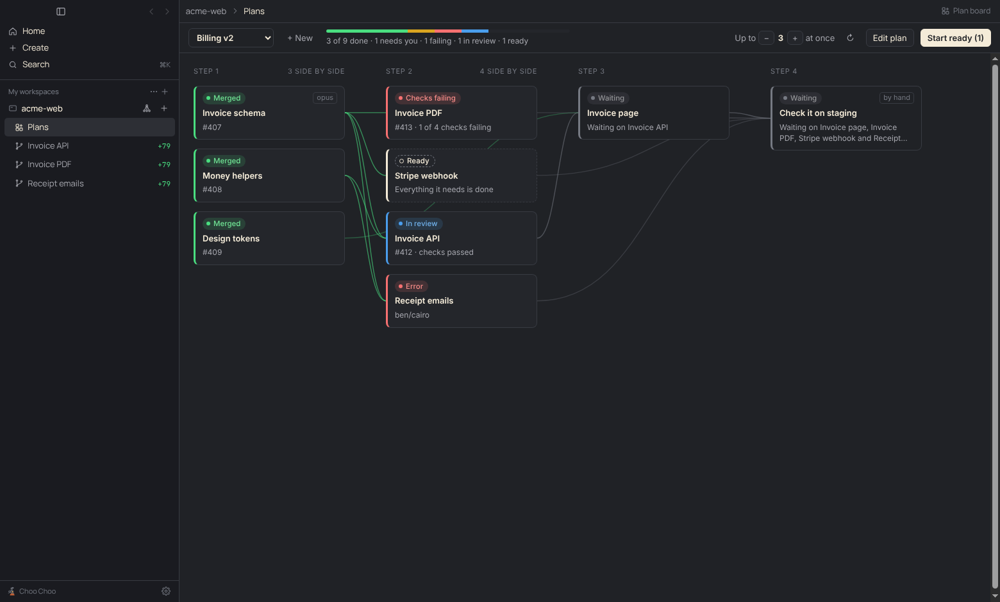

# Plan board

An add-on for [Choo Choo](https://github.com/Benbentwo/choo-choo). It splits a big piece of work into tasks, draws what depends on what, and runs each task as its own agent, branch and pull request. A task starts when the tasks it depends on are merged.



## Using it

1. In Choo Choo, open Settings › Add-ons, add the source `Benbentwo/choo-choo-addons`, install Plan board and turn it on. It needs a Choo Choo with project files for add-ons (`files:read`).
2. **Plans** appears under each project. Press **New plan**, or ask the project's orchestrator: "Write a plan for …".
3. Read the plan on the board. **Edit plan** shows it as text.
4. Press **Start ready**. Every task with nothing left to wait for gets a workspace and an agent, up to the plan's "at once" limit. From then on the plan is *running*: when a task's pull request is merged, the tasks that waited on it start by themselves.
5. Review and merge pull requests as usual. **Pause** stops new tasks from starting; agents already working carry on.

Each workspace a plan starts has a **Plan** tab beside it with its task: the brief, what it depends on and what it unblocks.

## The plan file

A plan is a Markdown file in the project, `.choo-choo/plans/<name>.plan.md`. It is text so that it diffs, can be reviewed in a pull request and reaches coworkers through git.

```markdown
---
title: Billing v2
parallel: 3
---

What every agent should know: the goal, conventions, where the spec is.

## Invoice model
- id: invoice-model
- model: opus

The brief: what to build, in enough detail for an agent that has seen nothing else.

### Done when
- Migration and model exist, with tests

## Invoice API
- id: invoice-api
- depends on: invoice-model

## Check staging
- id: check-staging
- depends on: invoice-api
- manual: yes
```

| | |
|---|---|
| `title` | The plan's name on the board. Defaults to the first `# ` heading, then the file name. |
| `parallel` | How many agents may work at once, 1 to 8. Default 3. Choo Choo lets one add-on run at most 8. |
| `model` (top) | The model for tasks that don't name one. Otherwise your default. |
| `## Title` | A task. |
| `- id:` | Lowercase letters, digits and dashes, at most 32 characters. Defaults to the title. Keep it stable: the plan remembers a task's workspace by its id. |
| `- depends on:` | Task ids, separated by commas. |
| `- model:` | `opus`, `fable`, `sonnet`, `haiku` or `codex`. |
| `- manual: yes` | A step a person does and ticks off. No agent. |
| `### Done when` | A list the agent checks itself against. |

Text above the first task goes to every agent. The board lists what is wrong with a plan (an unknown dependency, a circle, a duplicate id) and won't start it until that is fixed.

## What a card says

| Status | Means |
|---|---|
| Ready | Nothing left to wait for. Start it, or run the plan. |
| Waiting | Something it depends on isn't done. |
| Running, In the cloud | Its agent is working. |
| Needs approval | Its agent is waiting for you to allow a tool. |
| Stopped, no pull request | Its agent finished a turn without opening a pull request. Usually a question for you. |
| Draft pull request, Checks running, In review | A pull request is open. |
| Checks failing, Has conflicts | The pull request needs work. While the plan runs, the agent is asked to fix it: once per set of failing checks, three times at most, then you get a notification. |
| Merged | Its pull request was merged. What waited on it can start. |
| Done | Ticked off by hand. |
| You do this | A manual task whose turn has come. |
| Error, Pull request closed, Workspace archived | Needs you. |

Only *Running*, *In the cloud* and *Needs approval* count toward the "at once" limit, so a pull request waiting for review doesn't hold the plan up.

## Where things are kept

- The plan is the file in the project. Changing it from the board is an ordinary uncommitted edit.
- What happened when the plan ran (which workspace does which task, which pull request, what merged) is in the add-on's own storage on your Mac, keyed by task id. Running a plan makes no commits. Coworkers who pull the plan file see the plan, and each of them runs it or not on their own machine.

## Tools for the orchestrator

`plan_help`, `plan_list`, `plan_read` (read-only, run without asking), and `plan_write`, `plan_start`, `plan_pause` (follow the orchestrator chat's permission setting). `plan_write` refuses a plan with problems and says what to fix. The skill in `skills/writing-plans` teaches an agent in a workspace the same format.

## Developing

No build step. The views are plain HTML and ES modules.

```
ui/plan.js        reading a plan, steps, statuses, what to start next (no DOM, no app)
ui/scheduler.js   the background page: moves plans forward, answers the orchestrator's tools
ui/data.js        where plans and their state are kept
ui/board.js       the Plans view
ui/task.js        the Plan tab beside a workspace
```

`npm test` at the repo root runs the tests with Node's own test runner. To try a change, add this repo's folder as a source in Choo Choo (Settings › Add-ons › Add source, paste the path): the app then reads the add-on straight from the folder.

## Not yet

Editing dependencies by dragging, a kanban view, review findings on cards, "New plan from" a Notion page or Linear project, a spend cap, and starting a task from another task's branch before it merges.
